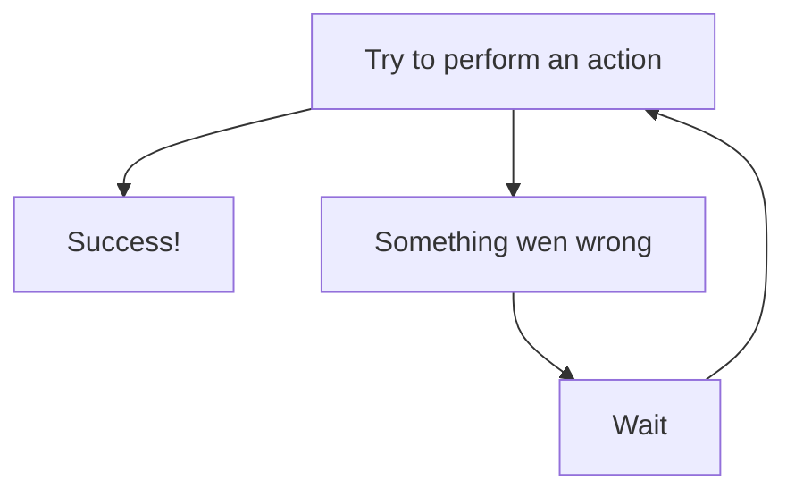

# python-webdriver

A thin wrapper around Selenium WebDriver that makes common Google Chrome automation tasks simpler, with retryable interactions, logging, and convenient browser utilities.

## Table of Contents

- [Features](#features)
- [Installation](#installation)
- [Quick start](#quick-start)
- [Usage and examples](#usage-and-examples)
  - [Locate and interact with elements](#locate-and-interact-with-elements)
  - [Using Context](#using-context)
  - [No more waiting around](#no-more-waiting-around)
  - [Setting Chrome executable](#setting-chrome-executable)
  - [Setting Chrome options](#setting-chrome-options)
  - [Save a screenshot or PDF](#save-a-screenshot-or-pdf)
  - [Enable network throttling](#enable-network-throttling)
- [License](#license)

## Features

- Start, use, and close a Chrome WebDriver with a small API.
- Locate elements by CSS selector, ID, class, name, tag, XPath, link text, or attribute.
- Type, clear, click, scroll, and drag elements with configurable retries.
- Configure Chrome options, including headless mode, window size, and download location.
- Save page screenshots and print pages to PDF.
- Emulate offline, 2G, 3G, and 4G network conditions.
- Use Selenium's underlying WebDriver directly when you need its full API.
- Log browser activity and retry attempts with Loguru.

## Installation

```bash
pip install python-webdriver
```

Requires **Python 3.14 or newer** and **Google Chrome**. `ChromeDriver` defaults to the standard Windows Chrome installation path. If Chrome is installed elsewhere, pass its executable path using `binary_path`.

## Quick start

```python
from python_webdriver import ChromeDriver

browser = ChromeDriver()
browser.options.set_start_maximized()  # Optional
browser.start()

try:
    # Navigation
    browser.goto("https://www.selenium.dev/selenium/web/web-form.html")
    # Element interaction
    text_box = browser.find_element().by_id("my-text-id")
    browser.type(text_box, "Hello from python-webdriver")
    browser.click(browser.find_element().by_css_selector("button"))
    # Page title
    print(browser.get_driver().title) # Outputs: Web form - target page
finally:
    browser.quit()

```

## Usage and examples

### Locate and interact with elements

`find_element()` returns a locator class to help you find web page elements by `id`, `class`, `CSS selector`, `XPath`, and more.

```python
browser.goto("https://quotes.toscrape.com")

# Locating elements by class name
locator = browser.find_element().by_class("quote")  # Returns a locator object
first_quote = locator.get_element()  # Returns a Selenium WebElement object of the first element matching the locator
print(first_quote.text)

all_quotes = locator.get_all_elements()  # Same as above but returns a list of all matching elements

# Locating elements by XPath
browser.click(
    browser.find_element().by_xpath("//a[text()='Login']")  # Clicks the login link
)
```

### Using context

Passing `context` to find_element will limit the scope of the search.

```python
browser.goto("https://quotes.toscrape.com")

# Locates the first quote element
quote_locator = browser.find_element().by_class("quote")

tags = browser.find_element(
    context=quote_locator  # Locator will only search for elements within this context instead of the whole page
).by_css_selector("a.tag")

for tag in tags.get_all_elements():
    print(tag.text)
```

### No more waiting around

Methods such as `click`, `type`, `clear`, and a few others were built with a "try until it works" philosophy, which basically boils down to:



In more technical terms, these methods were implemented using the function `retry_on_exception`, wich will try to invoke the callable passed in `func` and, if an exception occurs, tries to call it again up to `max_attempts` times with a wait period of `polling_seconds` seconds between retries.

```python
from python_webdriver.functions import retry_on_exception


def _action():
    return "Wolves hunt in packs."


string = retry_on_exception(
    func=_action,
    max_attempts=15,
    polling_seconds=2,
)

print(string)  # Outputs: Wolves hunt in packs.

```

This allows you to write more natural and sequential code, without littering your codebase with `time.sleep` everywhere.

```python
browser.goto("https://www.scrapethissite.com")

# Click login button
browser.click(browser.find_element().by_attribute("href", "/login/"))

# Fill form fields
browser.type(browser.find_element().by_id("email"), "email@provider.com")
browser.type(browser.find_element().by_id("password"), "password123")

# Submit form
browser.click(browser.find_element().by_xpath("//input[@type='submit']"))
```

And when something **does** go wrong, it's easy to debug and handle

```python
try:
    browser.goto("https://quotes.toscrape.com")
    # This will raise NoSuchElementException after the 5th retry
    browser.click(
        browser.find_element().by_id("non-existent-id"),
        max_retries=5,
        timeout=0.5,  # 500 milliseconds
    )
except Exception as e:
    print(f"An error occurred: {e}")
finally:
    browser.quit()
```


### Setting Chrome executable

`ChromeDriver` uses the default installation directory of Google Chrome

```python
from python_webdriver import ChromeDriver

# Uses the Chrome executable located in "C:\Program Files\Google\Chrome\Application\chrome.exe"
browser = ChromeDriver()
browser.start()
```

You can configure `ChromeDriver` to use a different Chrome executable by passing the `binary_path` argument

```python
# Plain string
browser = ChromeDriver(
    binary_path="C:\\Testing\\Chrome\\bin\chrome.exe"
)
browser.start()
```

```python
from pathlib import Path

# Path objects work too
browser = ChromeDriver(
    binary_path=Path(r"C:\Testing\Chrome\bin\chrome.exe")
)
browser.start()
```

### Setting Chrome options

You can set various Chrome options via the options interface. Some frequently used options have their own methods.

```python
from python_webdriver import ChromeDriver

browser = ChromeDriver()

# These options must be set before callint browser.start() and can not be changed after the browser has started
browser.options.set_binary_location(r"C:\Testing\Chrome\bin\chrome.exe")  # Chrome executable can also be set through options
browser.options.set_start_maximized()  # Starts the browser window maximized
browser.options.set_headless_mode()  # Starts the browser in headless mode (no GUI)
browser.options.set_download_path("C:\\Testing\\Downloads")  # Sets the default download path for files

browser.start()

```

### Save a screenshot or PDF

You can save a screenshot of the entire page using `save_screenshot_page` and passing the directory to save the screenshot as argument, which will be created automatically if it does not already exist.

If successful, `save_screenshot_page` will return a Path object and the file name will be a timestamp of when the screenshot was taken (YYYYMMDD_HHMMSS.mm.png)

```python
screenshot_path = browser.save_screenshot_page("C:\\Testing\\Screenshots")  # returns Path("C:\\Testing\\Screenshots\\20261102_225017.743293.png")

if screenshot_path:
    print(f"Screenshot saved at: {screenshot_path}")
else:
    print("Failed to save screenshot.")
```

Alternatively, you can save the current page as a PDF document using `page_to_pdf`

```python
browser.page_to_pdf(
    "C:\\Testing\\Downloads",
    file_name="page.pdf",  # File name. Must contain the extension (.pdf)
    hide_elements=(".cookie-banner", "#page-header", ".page-footer")  # Optional. If provided, elements matching these selectors will be hidden so they don't appear in the PDF.
)
```

### Enable network throttling

You can enable a network throttling profile to simulate a slower or no internet connection. Useful when creating robust automations that don't break on shaky internet connections.
Just remember to disable network throttling in production.

```python
from python_webdriver import ChromeDriver, ChromeNetworkThrottlingProfile
import os

browser = ChromeDriver()
browser.start()

if os.environ.get("ENABLE_NETWORK_THROTTLING"):
    browser.enable_network_throttling(ChromeNetworkThrottlingProfile.CELLULAR_3G)

browser.goto("https://www.example.com")

```

Available network throttling profiles are:

* OFFLINE
* SLOW_2G
* CELLULAR_2G
* CELLULAR_3G
* CELLULAR_4G

## License

This project is distributed under the [MIT License](LICENSE).
