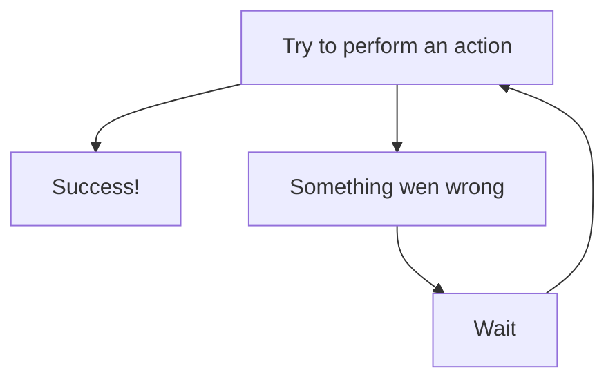

# python-webdriver

A thin wrapper around Selenium WebDriver that makes common Google Chrome automation tasks simpler, with retryable interactions, logging, and convenient browser utilities.

## Features

- Start, use, and close a Chrome WebDriver with a small API.
- Locate elements by CSS selector, ID, class, name, tag, XPath, link text, or attribute.
- Type, clear, click, scroll, and drag elements with configurable retries.
- Configure Chrome options, including headless mode, window size, and download location.
- Save page screenshots and print pages to PDF.
- Emulate offline, 2G, 3G, and 4G network conditions.
- Use Selenium's underlying WebDriver directly when you need its full API.
- Log browser activity and retry attempts with Loguru.

## Installation

```bash
pip install python-webdriver
```

Requires **Python 3.14 or newer** and **Google Chrome**. `ChromeDriver` defaults to the standard Windows Chrome installation path. If Chrome is installed elsewhere, pass its executable path using `binary_path`.

## Quick start

```python
from python_webdriver import ChromeDriver

browser = ChromeDriver()
browser.options.set_start_maximized()  # Optional
browser.start()

try:
    # Navigation
    browser.goto("https://www.selenium.dev/selenium/web/web-form.html")
    # Element interaction
    text_box = browser.find_element().by_id("my-text-id")
    browser.type(text_box, "Hello from python-webdriver")
    browser.click(browser.find_element().by_css_selector("button"))
    # Page title
    print(browser.get_driver().title) # Outputs: Web form - target page
finally:
    browser.quit()

```

## Usage and examples

### Locate and interact with elements

`find_element()` returns a locator class to help you find web page elements by `id`, `class`, `CSS selector`, `XPath`, and more.

```python
browser.goto("https://quotes.toscrape.com")

# Locating elements by class name
locator = browser.find_element().by_class("quote")  # Returns a locator object
first_quote = locator.get_element()  # Returns a Selenium WebElement object of the first element matching the locator
print(first_quote.text)

all_quotes = locator.get_all_elements()  # Same as above but returns a list of all matching elements

# Locating elements by XPath
browser.click(
    browser.find_element().by_xpath("//a[text()='Login']")  # Clicks the login link
)
```

### Using Context

Passing `context` to find_element will limit the scope of the search.

```python
browser.goto("https://quotes.toscrape.com")

# Locates the first quote element
quote_locator = browser.find_element().by_class("quote")

tags = browser.find_element(
    context=quote_locator  # Locator will only search for elements within this context instead of the whole page
).by_css_selector("a.tag")

for tag in tags.get_all_elements():
    print(tag.text)
```

### No more waiting around

Methods such as `click`, `type`, `clear`, and a few others were built with a "try until it works" philosophy, which basically boils down to:



In more technical terms, these methods were implemented using the function `retry_on_exception`, wich will try to invoke the callable passed in `func` and, if an exception occurs, tries to call it again up to `max_attempts` times with a wait period of `polling_seconds` seconds between retries.

```python
from python_webdriver.functions import retry_on_exception


def _action():
    return "Wolves hunt in packs."


string = retry_on_exception(
    func=_action,
    max_attempts=15,
    polling_seconds=2,
)

print(string)  # Outputs: Wolves hunt in packs.

```

This allows you to write more natural and sequential code, without littering your codebase with `time.sleep` everywhere.

```python
browser.goto("https://www.scrapethissite.com")

# Click login button
browser.click(browser.find_element().by_attribute("href", "/login/"))

# Fill form fields
browser.type(browser.find_element().by_id("email"), "email@provider.com")
browser.type(browser.find_element().by_id("password"), "password123")

# Submit form
browser.click(browser.find_element().by_xpath("//input[@type='submit']"))
```

And when something **does** go wrong, it's easy to debug and handle

```python
try:
    browser.goto("https://quotes.toscrape.com")
    # This will raise NoSuchElementException after the 5th retry
    browser.click(
        browser.find_element().by_id("non-existent-id"),
        max_retries=5,
        timeout=0.5,  # 500 milliseconds
    )
except Exception as e:
    print(f"An error occurred: {e}")
finally:
    browser.quit()
```


### Configure Chrome

Set options before starting the browser:

```python
from pathlib import Path
from python_webdriver import ChromeDriver

browser = ChromeDriver(
    binary_path=Path(r"C:\Program Files\Google\Chrome\Application\chrome.exe")
)
browser.options.set_headless_mode()
browser.options.set_start_maximized()
browser.options.set_download_path("./downloads")
browser.start()
```

Use `browser.options.set_option("--some-chrome-flag")` or `set_experimental_option(name, value)` for additional Chrome settings.

### Retry an interaction

Browser interactions such as `type`, `clear`, and `click` retry when Selenium raises an exception. For example:

```python
search_box = browser.find_element().by_name("q")
browser.type_and_enter(search_box, "Selenium", max_retries=5, timeout=0.5)
```

You can also use the standalone retry helper:

```python
from python_webdriver.functions import retry_on_exception

result = retry_on_exception(
    func=some_operation,
    max_attempts=3,
    polling_seconds=0.5,
)
```

### Save a screenshot or PDF

```python
browser.save_screenshot_page("./screenshots")
browser.page_to_pdf("./exports", file_name="page.pdf", hide_elements=(".cookie-banner",))
```

`page_to_pdf` returns the PDF contents as bytes and also saves the PDF to the given path.

### Emulate a network profile

```python
from python_webdriver import ChromeNetworkThrottlingProfile

browser.enable_network_throttling(ChromeNetworkThrottlingProfile.CELLULAR_3G)
```

## License

This project is distributed under the [MIT License](LICENSE).
